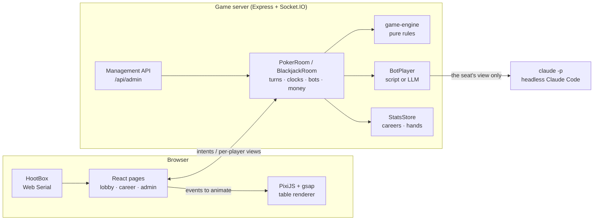

# OWL IN · KSU Card Club

**Multiplayer Texas Hold'em and Blackjack where AI players sit at every table.**

OWL IN is a card club you play in the browser. Everyone on the same network opens one address on a laptop or a
phone, picks a name, and sits down with **$10,000 in Dining Dollars** (play money). Bots fill the empty seats, and some
of those bots are **Claude**: each of their decisions is a real LLM call that sees exactly what a human in that seat
would see, and nothing more.

Built by **Yusuf Abdulahi** for the **KSU AI Club Hackathon 2026** (IEEE CS Game Sprint and itcan.do tracks).

---

## Highlights

- **AI players.** Every poker table mixes rule-based bots with LLM bots driven by the headless Claude Code CLI. An admin
  can change how many bots are AI, or pin any single bot to script or AI, while hands are being played. If an LLM call
  fails or is too slow, the bot falls back to its script for that decision, so the game never stalls.
- **Fair by construction.** The server holds all the game state. Each player and each bot gets its own view, and hidden
  cards never leave the server. Chips are conserved: bankrolls, tables and the house bank always add up to the same
  total, and the admin panel checks that live.
- **Two full games.**
  - **Texas Hold'em:** 8 seats, side pots, min-raise rules, short all-ins, a per-player clock and a ready-up step between hands.
  - **Blackjack:** a 6-deck shoe that persists between rounds, dealer stands on all 17s, blackjack pays 3:2, plus double,
    split, insurance and late surrender. Up to 3 betting spots per player.
- **An animated table.** PixiJS and gsap animate every deal, bet, chip movement and payout, on a black and gold
  (KSU colours) table that stays steady while numbers change.
- **Careers and a leaderboard.** Every poker hand and blackjack round is recorded. Your career page shows win rates,
  money won from players versus from bots, a chart of your chips over time, and every table session hand by hand.
  Careers can be public or private.
- **Admin panel and management API.** On the server PC: tables, players, kicks, bans, timeouts, bankroll changes, live
  AI statistics, and a searchable log of every hand, AI decision and admin action.
- **HootBox.** A hardware controller built from the ELEGOO MEGA2560 kit: a rotary dial and two buttons. You can play a
  whole game with it, from the lobby to the table and back.
- **Live presentation.** The hackathon deck is one self-contained HTML file that graphs the audience's play while they
  play, and falls back to sample data when it's opened offline.

---

## Quick start

**You'll need:** Node.js 26+ and npm 12+. For the AI bots, you also need the
[Claude Code CLI](https://docs.claude.com/en/docs/claude-code) installed and signed in. Without it, every bot plays by
its script.

```bash
git clone https://github.com/BigJella/owl-in.git
cd owl-in
npm install
npm run dev
```

| Open | What it is |
|---|---|
| `http://localhost:5173` | The game |
| `http://<this-pc's-LAN-IP>:5173` | The game from any other device on the same network (allow Node through the firewall if asked) |
| `http://localhost:5173/admin.html` | The admin panel (this computer only) |
| `http://localhost:3000/present` | The hackathon deck with live data |

To play with no AI bots at all, run `OWL_LLM_BOTS=0 npm run dev`.

### Configuration

Server settings live in `apps/server/.env`. Copy [`apps/server/.env.example`](apps/server/.env.example) to get started.
Real environment variables override it.

| Variable | Default | Meaning |
|---|---|---|
| `OWL_DEFAULT_BOTS` | `4` | Bots per new poker table (0–8) |
| `OWL_LLM_BOTS` | `2` | How many of those bots are AI: a number or `all` |
| `OWL_LLM_MODEL` | `claude-haiku-5-5` | The model for bot decisions |
| `OWL_LLM_TIMEOUT_MS` | `15000` | A slower decision falls back to the script |
| `OWL_CLAUDE_BIN` | `claude` | The path to the Claude Code CLI |
| `PORT` | `3000` | The game server port |

These are the defaults for new tables. Each table's bot and AI counts can be changed live from the admin panel.

---

## How to play

**Texas Hold'em.** Pick a table in the lobby and buy in for 20 to 100 big blinds. You join at the next hand and take
over the seat of the bot whose stack is closest to your buy-in. On your turn you can fold, check, call or raise (presets,
a slider or a typed amount). Your clock gains 20 seconds each turn, up to 120 seconds. If it runs out, you check, or
fold if you can't check. Between hands everyone readies up. If you bust, you have 30 seconds to reload or cash out.
Cashing out mid-hand is queued: you play the hand out first. Leaving a table locks you out of it for 30 minutes.

**Blackjack.** Bet on up to 3 of the 7 spots during the 15-second betting window. Betting on a bot's spot takes it over.
The dealer peeks for blackjack on an ace or a ten. Insurance is offered when the dealer shows an ace, and you can
surrender as your first decision. The shoe is only reshuffled once the cut card comes out, and the felt shows how full
the shoe and the discard tray are.

---

## Architecture



- **The server is the only authority.** Clients send intents (`poker:act`, `blackjack:bet`, ...) that are validated
  with zod. Each human gets their own table view. Bots get the exact same per-seat view through the same `Player` interface.
- **A pure, tested engine.** `packages/game-engine` has no framework imports. Every change to the game state returns a
  list of events (`holeCardsDealt`, `playerActed`, `potAwarded`, ...). The events carry no hidden information, and the
  client animates them before snapping to the authoritative view.
- **One bot class, two brains.** `BotPlayer` holds a deterministic `RuleBasedStrategy` and an `LlmStrategy`, and its mode
  can switch between decisions. An LLM decision is one headless CLI call:

  ```
  claude -p --model claude-haiku-5-5 --output-format json --json-schema <action schema> --tools "" …
  ```

  The prompt contains only the seat's own cards, the board, each player's stack, bet and position, and the hand's
  betting log. The answer is checked against the legal actions before it's applied. A decision takes about 2–6 s and
  costs about $0.0006.
- **One management API, three users.** The admin panel, the itcan.do live page and the presentation all read
  `/api/admin/*`. It only answers requests from this computer, and every write needs an `X-Owl-Admin: 1` header.

### Repository layout

```
apps/
  client/            React 19 + Vite + PixiJS 8 + gsap: the player site and the admin panel (admin.html)
  server/            Express + Socket.IO (run with tsx): rooms, players, bots, AI, admin API, stats
packages/
  game-engine/       Pure Hold'em and Blackjack rules (state machines that return events)
  shared/            Types and constants shared by the client and the server
hardware/hootbox/    HootBox firmware (Arduino sketch) and wiring guide
it/owl-live/         itcan.do live chat page for admins
presentation/        The hackathon deck: src/ (sources) and owl-in.html (the built, self-contained file)
scripts/             End-to-end bot tests, the itcan.do bridge, the deck build, the card art generator
```

---

## Development

| Command | What it does |
|---|---|
| `npm run dev` | Server on `:3000` and client on `:5173`, both reloading on change |
| `npm run typecheck` | `tsc --noEmit` in every workspace |
| `npm test` | Vitest: the poker and blackjack engines, rooms (fake timers, soak tests), HootBox protocol and navigation |
| `npm run build` | Production build of the client |
| `node scripts/bots.mjs [url] [hands] [clients]` | End-to-end poker test: socket clients play real hands; checks bot replacement, rebuys and that no hole cards leak |
| `node scripts/blackjack-bots.mjs [url] [rounds] [clients]` | End-to-end blackjack test: checks bot spots, spot limits and that the dealer's hole card never leaks |
| `npm run present:build` | Builds `presentation/owl-in.html` from `presentation/src/` |
| `npm run it:live` | Feeds the itcan.do live page from the management API |

The test suite includes a chip conservation fuzz test that plays many random hands and checks that no chip is ever
created or lost.

---

## Management API

All endpoints are under `http://localhost:3000/api/admin` and only answer requests from this computer. Writes need the
`X-Owl-Admin: 1` header. Responses never include browser tokens, IP addresses or hidden cards.

| Endpoint | Does |
|---|---|
| `GET /snapshot` | Everything: totals (with the conservation check), tables and seats, players, timeouts, AI stats |
| `GET /tables` · `/tables/:id` · `/players` · `/timeouts` · `/llm?limit=` | Parts of the snapshot |
| `GET /players/:id/career` · `/players/:id/sessions/:sessionId` | A player's career, and one table session's hands |
| `GET /log` | The event log (hands, AI decisions, admin actions), with filters and paging |
| `GET /network` | This PC's LAN addresses and the client port |
| `POST /tables` · `PATCH /tables/:id` · `POST /tables/:id/close` | Create a table, change its bot and AI counts, close it |
| `POST /bots/:id/mode` | Set a poker bot to `auto`, `script` or `llm` |
| `POST /players/:id/kick` · `/ban` · `/unban` · `/bankroll` · `/rename` | Moderation |
| `PUT /timeouts` · `DELETE /timeouts` | Add, change or remove a table or sitewide timeout |

```bash
curl -s localhost:3000/api/admin/snapshot
curl -s -X POST localhost:3000/api/admin/players/<id>/kick \
  -H "Content-Type: application/json" -H "X-Owl-Admin: 1" -d '{"timeoutMinutes":10}'
```

---

## HootBox (ELEGOO kit)

A KY-040 rotary encoder and two push buttons on an ELEGOO MEGA2560 R3. The board sends one line per input over USB
serial (`R+1`, `R-1`, `P1`/`P0`, `A1`/`A0`, `B1`/`B0`), and the browser reads it with the Web Serial API.

| Input | Does |
|---|---|
| Turn the dial | Changes an amount, or moves the highlight |
| Press the dial | Commits a dialed amount (raise, bet) |
| **A** | Yes / OK / check or call / hit |
| **B** | No / back / stand |
| Hold **B** for 1 s | Fold or leave |

It works in Chrome or Edge on `http://localhost:5173`, on the computer the board is plugged into. Wiring, upload steps
and the full protocol are in [`hardware/hootbox/README.md`](hardware/hootbox/README.md).

---

## Limitations

- **Everything lives in memory.** Restarting the server resets bankrolls, careers, names and timeouts.
- **The admin panel has no login.** It relies on only answering requests from the server's own computer.
- **Blackjack bots aren't AI yet.** They play basic strategy; only the poker bots use the LLM.
- **The card art is placeholder SVGs.**

## Roadmap

- Bot personalities (tight, loose, aggressive) and optional one-line table talk
- LLM blackjack bots
- SQLite persistence for bankrolls, careers and hand history
- Real card art, sounds, chat and spectator mode

---

## Built with

TypeScript · Node.js · React 19 · Vite · PixiJS 8 · gsap · Socket.IO · Express · zod · Vitest · tsx · pokersolver ·
Claude Code CLI (Claude Haiku) · itcan.do · Arduino · Web Serial · Inter and Oswald fonts (@fontsource)

Dining Dollars are play money: nothing in OWL IN involves real currency.
